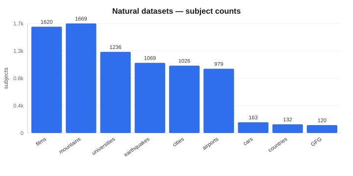
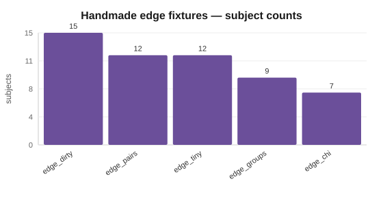
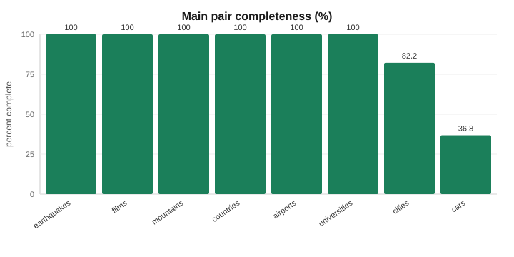
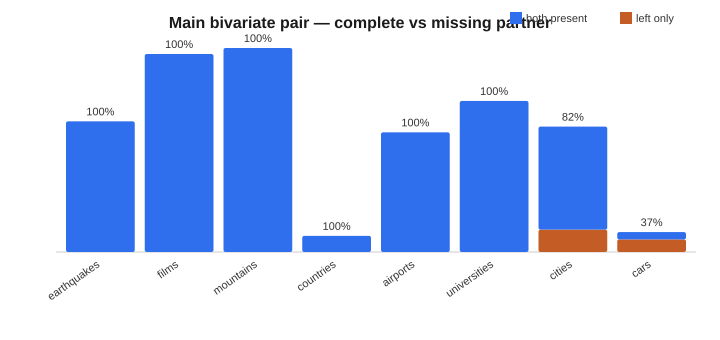
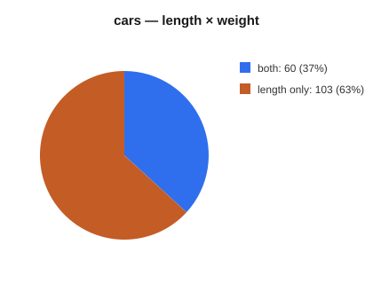
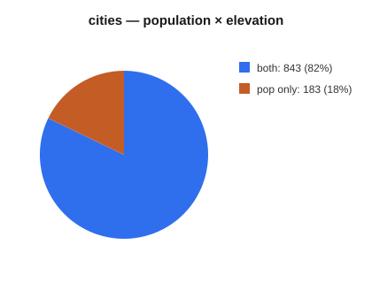
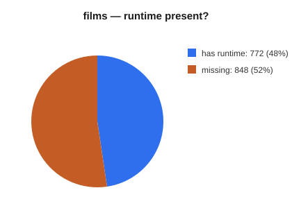

# Exploratory data analysis (EDA)

Exploratory overview of every Turtle fixture used by this repository’s tests.

| | |
|---|---|
| **Natural fixtures** | [`src/test/resources/*.ttl`](src/test/resources/) |
| **Handmade edge fixtures** | TTL: [`src/test/resources/custom-data/`](src/test/resources/custom-data/) · tables: [`custom-data/`](custom-data/) |
| **Method** | Static scan of Turtle subjects / properties / numeric literals (not a SPARQL run) |
| **Charts** | SVG under [`docs/eda-charts/`](docs/eda-charts/) (render on GitHub + most Markdown previews) |
| **Related** | [README.md](README.md) · [EDGE_CASE_REPORT.md](EDGE_CASE_REPORT.md) |

Numbers below are approximate counts from the files as checked into the repo. They describe **what is in the graph**, not what a particular query returns after joins/`OPTIONAL`.

---

## 1. Inventory

| Dataset | Subjects (approx.) | Primary type | Role |
|---------|-------------------|--------------|------|
| [`earthquakes.ttl`](src/test/resources/earthquakes.ttl) | 1 069 | `dbo:Earthquake` | Natural / happy-path |
| [`cars.ttl`](src/test/resources/cars.ttl) | 163 | `dbo:Automobile` | Natural · incomplete pairs · dirty extremes |
| [`films.ttl`](src/test/resources/films.ttl) | 1 620 | `dbo:Film` | Natural · runtime often missing |
| [`cities.ttl`](src/test/resources/cities.ttl) | 1 026 | `dbo:City` | Natural · elevation often missing |
| [`mountains.ttl`](src/test/resources/mountains.ttl) | 1 669 | `dbo:Mountain` | Natural / happy-path |
| [`countries.ttl`](src/test/resources/countries.ttl) | 132 | `dbo:Country` | Natural / happy-path |
| [`airports.ttl`](src/test/resources/airports.ttl) | 979 | `dbo:Airport` | Natural / happy-path |
| [`universities.ttl`](src/test/resources/universities.ttl) | 1 236 | `dbo:University` | Natural / happy-path |
| [`GFG_example.ttl`](src/test/resources/GFG_example.ttl) | 120 | `ex:Person` | Tiny complete chi-squared demo |
| [`pairs`](custom-data/pairs.md) | 12 | `ex:Student` | Edge #1 incomplete pairs |
| [`chi`](custom-data/chi.md) | 7 | `ex:Person` | Edge #1 chi_sq gaps |
| [`tiny`](custom-data/tiny.md) | 12 | `ex:Point` | Edge #2 tiny / empty |
| [`groups`](custom-data/groups.md) | 9 | `ex:Student` | Edge #3 GROUP BY |
| [`dirty`](custom-data/dirty.md) | 15 | `ex:Item` | Edge #4 dirty types |

### Charts — size of each fixture

---

## 2. How to read this EDA

### Completeness of a property pair

For two properties `L` and `R` on the same type:

| Bucket | Meaning |
|--------|---------|
| **both** | Subject has `L` and `R` → survives a REQUIRED join |
| **left_only** | Has `L`, missing `R` |
| **right_only** | Has `R`, missing `L` |
| **neither** | Has the type but neither property |

Happy-path tests usually use REQUIRED patterns, so only **both** rows feed the aggregate. Edge tests use `OPTIONAL` so left/right-only rows can enter as unbound.

### Dirty numerics

Some DBpedia-scraped values are nonsense for physics (negative lengths, magnitude −10, etc.). They still sit in the graph and can skew means/correlations if not filtered.

---

## 3. Natural datasets (detail)

### 3.1 [`earthquakes.ttl`](src/test/resources/earthquakes.ttl)

| | |
|---|---|
| **n** | 1 069 earthquakes |
| **Core props** | `dbp:casualties`, `dbp:magnitude` on **all** subjects; most also have lat/long |
| **Pair casualties × magnitude** | **100% complete** (1 069 / 1 069) |

**Numeric sketch**

| Property | n | min | median | max | mean |
|----------|---|-----|--------|-----|------|
| `dbp:casualties` | 1069 | −10 | 53 | 2.6e5 | ~4.8e3 |
| `dbp:magnitude` | 1069 | −10 | 6.8 | 9.4 | ~6.82 |

**EDA notes**

- Structurally clean for the main pair (no missing casualties/magnitude).
- **Dirty:** a few **negative** casualties and magnitudes (min −10) — not physically meaningful; good stress for robustness, bad for naive averages.
- Lat/long almost complete (~1 062).

**Used by:** [`PearsonTest`](src/test/java/com/kari3600/me/statistics_rdf4j/PearsonTest.java), [`CovarianceTest`](src/test/java/com/kari3600/me/statistics_rdf4j/CovarianceTest.java), [`PercentileTest`](src/test/java/com/kari3600/me/statistics_rdf4j/PercentileTest.java), [`ProbabilityTest`](src/test/java/com/kari3600/me/statistics_rdf4j/ProbabilityTest.java).

---

### 3.2 [`cars.ttl`](src/test/resources/cars.ttl)

| | |
|---|---|
| **n** | 163 automobiles |
| **Always present** | `dbp:length`, `dbp:wheelbase`, `rdfs:label` |
| **Often missing** | `dbp:weight` (60/163), `dbp:width` (118/163) |

**Pair length × weight**

| both | left_only (length, no weight) | complete % |
|------|-------------------------------|------------|
| 60 | 103 | **36.8%** |

**Numeric sketch**

| Property | n | min | median | max |
|----------|---|-----|--------|-----|
| `dbp:length` | 163 | −1500 | 1988 | 5.79e4 |
| `dbp:weight` | 60 | 2.2 | 1900 | 2.7e4 |
| `dbp:wheelbase` | 163 | −243 | 1963 | 1.8e7 |
| `dbp:width` | 118 | −100 | 301.5 | 1.64e4 |

**EDA notes**

- **Best natural fixture for missing-value edges:** majority lack weight → REQUIRED pearson uses only 60 cars; `OPTIONAL` weight poisons aggregates (see edge report).
- Extremely wide / negative lengths and wheelbases → unit mix + scrape errors.
- Tiny absurd weights (e.g. 2.2) look like unit or placeholder junk.

**Used by:** happy-path pearson/covariance/percentile; many `carsOptional*` methods in `*EdgeTest` classes.

---

### 3.3 [`films.ttl`](src/test/resources/films.ttl)

| | |
|---|---|
| **n** | 1 620 films |
| **Pair budget × gross** | **100% complete** |
| **Runtime** | ~772 / 1620 (~47.7%) have `dbo:runtime` |

**Numeric sketch**

| Property | n | min | median | max |
|----------|---|-----|--------|-----|
| `dbo:budget` | 1620 | 1 | 5e6 | 7e10 |
| `dbo:gross` | 1620 | ~1.15 | 6e6 | 2.06e10 |
| `dbo:runtime` | 772 | 1800 | 6300 | ~6.6e4 |

**EDA notes**

- Budget/gross always paired → stable for correlation/covariance happy paths.
- Runtime missing on ~half the films → univariate percentile on runtime is a smaller sample.
- Heavy right tail (blockbuster budgets/gross) → means ≫ medians; correlation can be outlier-sensitive.
- Occasional noisy type/label scrape artifacts in raw Turtle.

**Used by:** pearson, covariance, percentile (runtime).

---

### 3.4 [`cities.ttl`](src/test/resources/cities.ttl)

| | |
|---|---|
| **n** | 1 026 cities |
| **Always** | `dbo:populationTotal`, `dbo:areaTotal` |
| **Often missing** | `dbo:elevation` (843/1026) |

**Pair population × elevation**

| both | left_only | complete % |
|------|-----------|------------|
| 843 | 183 | **82.2%** |

**Numeric sketch**

| Property | n | min | median | max |
|----------|---|-----|--------|-----|
| `dbo:populationTotal` | 1026 | 0 | 3898 | ~5.3e6 |
| `dbo:areaTotal` | 1026 | 2e5 | ~1.6e7 | ~1.4e11 |
| `dbo:elevation` | 843 | −2 | 166 | 2468 |

**EDA notes**

- Second-best natural incomplete-pair fixture after cars (missing elevation).
- Population heavily skewed (median ~4k vs mean ~1.2e5).
- Area in huge square-metre style magnitudes → covariance numbers look enormous.

**Used by:** pearson/covariance/probability; `citiesOptional*` elevation tests.

---

### 3.5 [`mountains.ttl`](src/test/resources/mountains.ttl)

| | |
|---|---|
| **n** | 1 669 mountains |
| **Pair elevation × prominence** | **100% complete** |

| Property | n | min | median | max |
|----------|---|-----|--------|-----|
| `dbo:elevation` | 1669 | 74 | 2525 | 8586 |
| `dbo:prominence` | 1669 | 0 | 283 | 6961 |

**EDA notes**

- Structurally complete for the main pair.
- Elevations look plausible (metres); prominence has many small values and a long tail.
- Good “clean-ish” numeric corpus for percentile / pearson without missingness drama.

---

### 3.6 [`countries.ttl`](src/test/resources/countries.ttl)

| | |
|---|---|
| **n** | 132 countries |
| **Rich numeric props** | area, population, density, GDP fields, HDI, Gini — broadly complete on the scanned set |
| **Pair `dbp:hdi` × `dbp:gini`** | present on all 132 (also mirrored as `dbo:humanDevelopmentIndex` / `dbo:giniCoefficient`) |

| Property | n | min | median | max |
|----------|---|-----|--------|-----|
| `dbo:humanDevelopmentIndex` | 132 | 0.388 | 0.754 | 0.97 |
| `dbo:giniCoefficient` | 132 | 16.6 | 35.6 | 67 |

**EDA notes**

- Small n, high completeness → stable for country-level correlation demos.
- HDI bounded ~0–1; Gini typical inequality scale.
- Density property can contain extreme outliers (scrape/unit issues) — check before interpreting means.

---

### 3.7 [`airports.ttl`](src/test/resources/airports.ttl)

| | |
|---|---|
| **n** | 979 airports |
| **Pair elevation × `dbp:r1LengthF`** | **100% complete** |

| Property | n | min | median | max |
|----------|---|-----|--------|-----|
| `dbo:elevation` | 979 | −378 | 214.9 | 2548 |
| `dbp:r1LengthF` | 979 | 0 | 4652 | 2.5e4 |

**EDA notes**

- Complete pairs; elevation can be below sea level (valid) or extreme.
- Runway length 0 appears — placeholder/missing encoded as zero rather than absent triple.
- Used for weak-correlation / probability style tests.

---

### 3.8 [`universities.ttl`](src/test/resources/universities.ttl)

| | |
|---|---|
| **n** | 1 236 universities |
| **Pair students × endowment** | **100% complete** |

| Property | n | min | median | max |
|----------|---|-----|--------|-----|
| `dbo:numberOfStudents` | 1236 | 9 | 5088 | ~2.1e6 |
| `dbo:endowment` | 1236 | ~1.2 | ~8.9e7 | ~3.9e11 |

**EDA notes**

- Complete for the main pair, but endowment scale spans many orders of magnitude.
- Means pulled by mega-endowments / mega-campuses; median is more robust.
- Happy-path pearson here is near-zero in existing tests — weak linear link at this scale.

---

### 3.9 [`GFG_example.ttl`](src/test/resources/GFG_example.ttl)

| | |
|---|---|
| **n** | 120 persons |
| **Props** | `ex:gender`, `ex:order` on **all** |
| **Role** | Classic contingency table for `stat:chi_sq` |

**EDA notes**

- Fully complete categorical data — no missingness.
- Contrast with handmade [`chi`](custom-data/chi.md), which deliberately adds incomplete persons.

---

## 4. Handmade edge datasets (detail)

Full row tables: [`custom-data/`](custom-data/). Summary only here.

### 4.1 [`pairs`](custom-data/pairs.md) — incomplete pairs

| | math | english |
|--|------|---------|
| Present | 9 / 12 | 8 / 12 |
| Complete pairs (both) | **6** | |
| Left-only / right-only / neither | 3 / 2 / 1 | |

Designed so REQUIRED join ≠ OPTIONAL behavior. Perfect-line subset (cara…finn) gives pearson 1.0.

### 4.2 [`chi`](custom-data/chi.md) — categorical gaps

| Complete (gender+order) | Incomplete |
|-------------------------|------------|
| 4 | 3 |

Shows `chi_sq` still returning a number under `OPTIONAL` (unlike pearson).

### 4.3 [`tiny`](custom-data/tiny.md) — degenerate sizes

Cases: `empty`, `single`, `identical`, `constantX`, `two`.  
Documents NaN / 0.0 / NPE behaviors for tiny inputs.

### 4.4 [`groups`](custom-data/groups.md) — grouping

| Group | Complete pairs | Intent |
|-------|----------------|--------|
| A | 4 | Healthy line |
| B | 1 | Degenerate |
| C | 2 identical | No variance |
| D | 0 | Absent under REQUIRED |

### 4.5 [`dirty`](custom-data/dirty.md) — type junk

Cases cover clean numerics, string-as-number, mixed poison rows, all-true/false flags, multi-valued properties, empty conditional probability.

---

## 5. Cross-dataset comparison

### 5.1 Missingness for the “main” bivariate pair

| Dataset | Pair | Complete % | Best for |
|---------|------|------------|----------|
| earthquakes | casualties × magnitude | 100% | Clean join, dirty negatives |
| films | budget × gross | 100% | Strong correlation demos, skew |
| mountains | elevation × prominence | 100% | Clean numeric |
| countries | hdi × gini | 100% | Small-n clean |
| airports | elevation × runway | 100% | Weak corr / zeros |
| universities | students × endowment | 100% | Heavy skew |
| **cities** | population × elevation | **82%** | Natural missing elevation |
| **cars** | length × weight | **37%** | Natural missing weight |

### Charts — where incompleteness lives

### 5.2 Data-quality themes

1. **Missing triples** — cars (weight), cities (elevation), films (runtime).
2. **Sentinel zeros** — airport runway length 0 may mean “unknown”, not true zero.
3. **Impossible / negative numerics** — earthquakes, cars lengths/wheelbases.
4. **Scale chaos** — money, area m², endowment; means mislead; prefer medians / robust reads.
5. **Handmade fixtures** — intentionally tiny and ugly to pin library edge semantics.

### 5.3 Implications for statistics queries

| Query style | What the data does |
|-------------|-------------------|
| REQUIRED `L` + `R` | Silently drops incompletes; reported n is “both” only |
| `OPTIONAL` | Pulls incompletes in → most numeric aggregates go **unbound** (see [EDGE_CASE_REPORT.md](EDGE_CASE_REPORT.md)) |
| No filters on dirty values | Negatives and unit junk enter the estimator |
| Approx percentile | Sensitive to empty input (NPE) and out-of-range p |

---

## 6. Suggested follow-ups (optional)

- Per-dataset SPARQL profiles (histograms via `GROUP BY` bins) for one “hero” numeric each.
- Explicit filters in happy-path tests (`FILTER(?magnitude > 0)`) if dirty negatives should be excluded.
- Document expected **effective n** next to each assert (e.g. cars pearson uses 60 pairs, not 163 cars).

---

## 7. Reproducing the scan

A one-off scanner was used to produce subject/property/numeric summaries from the TTL files under `src/test/resources/`. Re-run any similar static parse after editing fixtures; do not treat this report as auto-updated.
