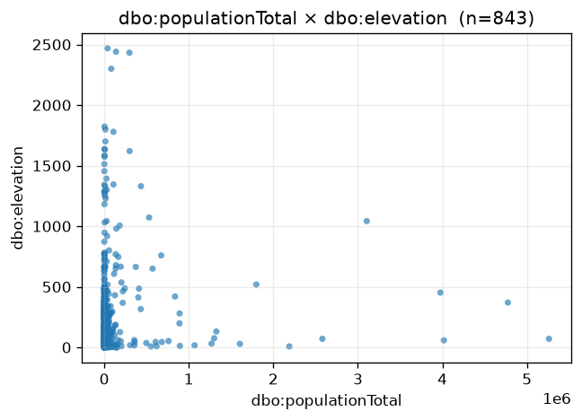
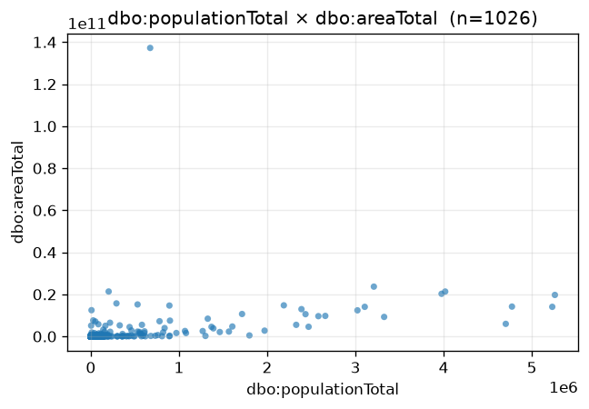

# Cities — EDA

| | |
|---|---|
| **Name** | Cities |
| **Source file** | [`cities.ttl`](../../src/test/resources/cities.ttl) |
| **Type** | Natural fixture (DBpedia-style scrape) |
| **Primary class** | `dbo:City` |
| **Used by** | Happy-path pearson / covariance / probability; edge tests for missing elevation |

---

## Description

Cities with population and area always present; elevation often missing. Second-best natural incomplete-pair fixture after cars.

---

## How many

| | Count |
|---|------:|
| Subjects (`dbo:City`) | **1026** |
| Distinct properties seen | 4 |

---

## What kind of values

| Property | Present | Completeness | Kind (observed) |
|----------|--------:|-------------:|-----------------|
| `dbo:areaTotal` | 1026 | **100.0%** | numeric |
| `dbo:populationTotal` | 1026 | **100.0%** | numeric |
| `rdfs:label` | 1026 | **100.0%** | string |
| `dbo:elevation` | 843 | **82.2%** | numeric |

### Numeric sketch (one value per subject)

| Property | n | min | median | max | Negatives |
|----------|--:|----:|-------:|----:|----------:|
| `dbo:areaTotal` | 1026 | 200000 | 1.578e+07 | 1.372e+11 | 0 |
| `dbo:populationTotal` | 1026 | 0 | 3898 | 5.261e+06 | 0 |
| `dbo:elevation` | 843 | -2 | 166 | 2468 | 1 |

---

## How complete it is

### Per property (% of 1026 subjects)

| Property | Present | Missing | Completeness |
|----------|--------:|--------:|-------------:|
| `dbo:areaTotal` | 1026 | 0 | **100.0%** |
| `dbo:populationTotal` | 1026 | 0 | **100.0%** |
| `rdfs:label` | 1026 | 0 | **100.0%** |
| `dbo:elevation` | 843 | 183 | **82.2%** |

### Main bivariate pair: `dbo:populationTotal` × `dbo:elevation`

| Bucket | Count | Meaning |
|--------|------:|---------|
| **both** | 843 | Has both |
| **left_only** | 183 | Has `dbo:populationTotal`, missing `dbo:elevation` |
| **right_only** | 0 | Has `dbo:elevation`, missing `dbo:populationTotal` |
| **neither** | 0 | Has type but neither property |

**Pair completeness: 82.2%** (843 / 1026).

### Pair: `dbo:populationTotal` × `dbo:areaTotal`

| Bucket | Count | Meaning |
|--------|------:|---------|
| **both** | 1026 | Has both |
| **left_only** | 0 | Has `dbo:populationTotal`, missing `dbo:areaTotal` |
| **right_only** | 0 | Has `dbo:areaTotal`, missing `dbo:populationTotal` |
| **neither** | 0 | Has type but neither property |

**Pair completeness: 100.0%** (1026 / 1026).

