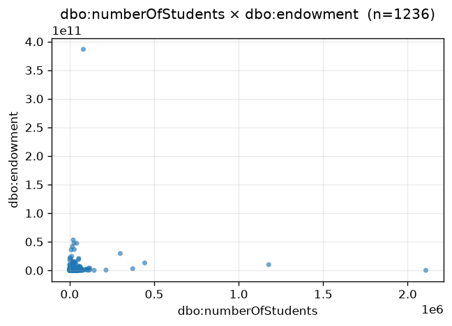

# Universities — EDA

| | |
|---|---|
| **Name** | Universities |
| **Source file** | [`universities.ttl`](../../src/test/resources/universities.ttl) |
| **Type** | Natural fixture (DBpedia-style scrape) |
| **Primary class** | `dbo:University` |
| **Used by** | Happy-path pearson / covariance |

---

## Description

Universities with student counts and endowment. Main pair is complete but endowment spans many orders of magnitude (heavy skew).

---

## How many

| | Count |
|---|------:|
| Subjects (`dbo:University`) | **1236** |
| Distinct properties seen | 3 |

---

## What kind of values

| Property | Present | Completeness | Kind (observed) |
|----------|--------:|-------------:|-----------------|
| `dbo:endowment` | 1236 | **100.0%** | numeric |
| `dbo:numberOfStudents` | 1236 | **100.0%** | numeric |
| `rdfs:label` | 1236 | **100.0%** | string |

### Numeric sketch (one value per subject)

| Property | n | min | median | max | Negatives |
|----------|--:|----:|-------:|----:|----------:|
| `dbo:endowment` | 1236 | 1.176 | 8.856e+07 | 3.866e+11 | 0 |
| `dbo:numberOfStudents` | 1236 | 9 | 5088 | 2.107e+06 | 0 |

---

## How complete it is

### Per property (% of 1236 subjects)

| Property | Present | Missing | Completeness |
|----------|--------:|--------:|-------------:|
| `dbo:endowment` | 1236 | 0 | **100.0%** |
| `dbo:numberOfStudents` | 1236 | 0 | **100.0%** |
| `rdfs:label` | 1236 | 0 | **100.0%** |

### Main bivariate pair: `dbo:numberOfStudents` × `dbo:endowment`

| Bucket | Count | Meaning |
|--------|------:|---------|
| **both** | 1236 | Has both |
| **left_only** | 0 | Has `dbo:numberOfStudents`, missing `dbo:endowment` |
| **right_only** | 0 | Has `dbo:endowment`, missing `dbo:numberOfStudents` |
| **neither** | 0 | Has type but neither property |

**Pair completeness: 100.0%** (1236 / 1236).

